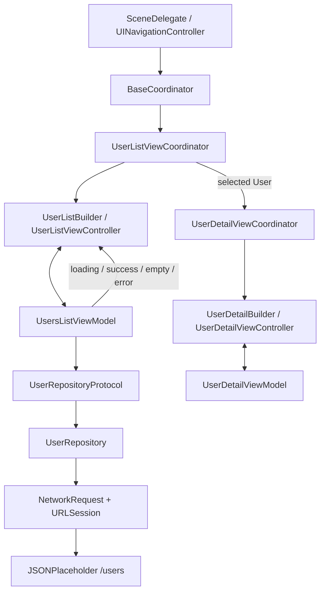

# ContactsAppWithJSONPlaceholder

ContactsAppWithJSONPlaceholder is an iOS application demonstrating the use of modern Swift architecture, clean coding practices, and robust UI/Unit testing. The app fetches user data from the [JSONPlaceholder](https://jsonplaceholder.typicode.com) API and displays it in a user-friendly interface.

---

## Features
- **User List:** Displays a list of users fetched from an API.
- **Search Functionality:** Enables users to search for contacts dynamically.
- **User Details:** Provides detailed information about each user, including email, phone, and website.
- **Custom Transitions:** Implements animated transitions for navigation.
- **Robust Testing:** Includes comprehensive Unit and UI test cases for reliability.

---

## Tech Stack

### Languages & Frameworks
- **Swift:** The primary programming language for iOS development.
- **UIKit:** Used for building the app’s user interface.
- **SnapKit:** Simplifies Auto Layout constraints using a declarative syntax.
- **Then:** Provides syntactic sugar for initializing objects.
- **SwiftUI:** Used for building reusable components, integrated into UIKit via `UIHostingController`.
- **XCTest:** Framework for writing Unit and UI tests.

### Architecture
The app follows the **Coordinator Pattern** for navigation, ensuring a modular and testable structure. This approach centralizes navigation logic, making it easier to manage transitions between screens and maintain a clean separation of concerns. It also employs a **ViewModel** layer to separate business logic from the view.

### Architecture at a glance



### Engineering decisions

| Decision | Reason and implementation |
| --- | --- |
| **Coordinator-based navigation** | `SceneDelegate` starts `BaseCoordinator`, which delegates list and detail flows to separate coordinators. Navigation is not owned by the ViewModels. |
| **MVVM with explicit UI states** | The list ViewModel manages fetching and case-insensitive name filtering; callback states let the controller render loading, success, empty, or error feedback. |
| **Protocol-oriented repository** | `UserRepositoryProtocol` decouples the list ViewModel from `UserRepository` and lets XCTest inject `MockUserRepository` for success/failure scenarios. |
| **Dedicated network boundary** | `EndPoint` builds the JSONPlaceholder `/users` URL; `NetworkRequest` wraps `URLSession`, dispatches completion to the main queue, and `UserRepository` decodes `[User]`. |
| **Programmatic UIKit** | List/detail screens are constructed in Swift; **SnapKit** expresses Auto Layout constraints and **Then** keeps view configuration concise. |
| **SwiftUI inside UIKit** | A custom animated `LoadingIndicator` is hosted by `UIHostingController` via `LoadingIndicatorView`, demonstrating incremental UIKit/SwiftUI interoperability. |
| **Test automation** | XCTest covers ViewModel/repository behavior and UI interactions. GitHub Actions runs iOS Simulator builds and the **unit-test target** on hosted macOS; the live-API-dependent UI tests are not yet part of that CI gate. |

### Demonstration scope

- The list fetches users from JSONPlaceholder. Selecting a row passes the existing `User` object through the detail coordinator; the detail screen does **not** issue a second user-detail API request.
- `UserDetailViewModel.loadUserDetails()` reports `.success` for the already-selected `User` without an artificial delay or random failure. The detail view does not perform another API fetch.
- This repository serves as an iOS architecture and interface portfolio sample. It is not presented as a production contacts service.

---

## Project Structure
```text
ContactsAppWithJSONPlaceholder/            # UIKit application target
  AppConfig/                                # App/scene startup
  Coordinator/                              # Navigation protocols
  Models/                                   # Codable API models
  Network/Repository/                       # Repository and protocol
  Network/Service/                          # Endpoint and HTTP layer
  Screens/                                  # List, details, base controllers
  UIComponents/                             # Cells and SwiftUI loading UI
  ViewModels/                               # List and detail state
  Extensions/                               # Shared UIKit/URLSession helpers
  Utils/                                    # Builders, types and protocols
ContactsAppWithJSONPlaceholderTests/       # Mocks and XCTest unit tests
ContactsAppWithJSONPlaceholderUITests/     # XCTest UI tests
Podfile                                     # Third-party dependencies
```
---

## Frameworks & Libraries

### SnapKit
**Why:** Simplifies Auto Layout constraints with a declarative syntax, making UI code cleaner and more maintainable.
```swift
containerView.snp.makeConstraints {
    $0.top.equalToSuperview().offset(16)
    $0.leading.trailing.equalToSuperview().inset(16)
}
```

### Then
**Why:** Reduces boilerplate code when initializing objects by allowing property configuration in a single block.
```swift
private let nameLabel = UILabel().then {
    $0.font = UIFont.systemFont(ofSize: 18, weight: .medium)
    $0.textColor = .label
}
```

### SwiftUI
**Why:** Enables the creation of reusable, declarative components, which can be seamlessly integrated into UIKit.
```swift
struct LoadingIndicator: View {
    var body: some View {
        ProgressView("Loading...")
    }
}
```

---

## Testing
The project includes comprehensive test coverage for both Unit and UI tests.

### Unit Tests
#### Framework: XCTest
Tests cover the following:
- **ViewModel Logic:** Validates state transitions and business logic.
- **Repository:** Ensures correct data fetching and error handling.

Example:
```swift
func testFetchUsersSuccess() {
    mockRepository.shouldReturnError = false
    let expectation = self.expectation(description: "Fetch users")
    mockRepository.fetchUsers { result in
        switch result {
        case .success(let users):
            XCTAssertEqual(users.count, 1)
        case .failure:
            XCTFail("Expected success, got failure")
        }
        expectation.fulfill()
    }
    waitForExpectations(timeout: 1.0)
}
```

### UI Tests
#### Framework: XCTest (XCUIApplication)
Tests cover:
- **User List Screen:** Verifies elements like the search bar and table view are displayed correctly.
- **Search Functionality:** Ensures accurate filtering of user results.
- **User Detail Navigation:** Validates navigation to and content of the detail screen.

Example:
```swift
func testUserDetailNavigation() {
    let cell = app.tables.cells.staticTexts["Leanne Graham"]
    XCTAssertTrue(cell.exists, "User cell should exist")
    cell.tap()
    let detailScreenTitle = app.staticTexts["User Details"]
    XCTAssertTrue(detailScreenTitle.exists, "User Details screen should be displayed")
}
```

---

## Installation

### Requirements
- **Xcode with iOS 18.2 SDK support:** The checked-in `.xcodeproj` specifies `IPHONEOS_DEPLOYMENT_TARGET = 18.2`.
- **iOS 18.2+** for the current project target. The `Podfile` separately specifies `platform :ios, '14.0'`; these settings are not aligned and should be reviewed before claiming compatibility with older iOS versions.

### Steps
1. Clone the repository:
    ```bash
    git clone https://github.com/fatihemres/ContactsAppWithJSONPlaceholder.git
    ```
2. Open the workspace:
    ```bash
    cd ContactsAppWithJSONPlaceholder
    open ContactsAppWithJSONPlaceholder.xcworkspace
    ```
    > **Note:** Ensure you open the project using the workspace file. The project includes CocoaPods dependencies, and opening it directly through the `.xcodeproj` file may result in build errors.
3. Run the app on the simulator or a physical device.

---

## Screenshots

<div style="display: flex; justify-content: space-around;">
    
    
</div>

---

## License
This project is licensed under the [MIT License](LICENSE).

---

## Acknowledgments
- [JSONPlaceholder](https://jsonplaceholder.typicode.com) for providing the mock API.
- The contributors who made this project possible.

---

## Contact
For questions or collaboration, please reach out at [fatihemresarman@gmail.com](mailto:fatihemresarman@gmail.com).
